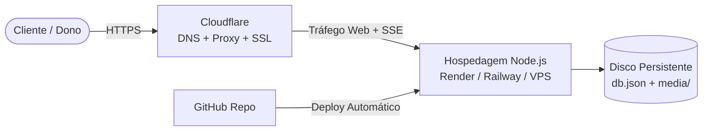

# Guia de Deploy: GitHub + Hospedagem + Cloudflare

Este guia explica como colocar o **Cardápio em Feed** no ar em ambiente de testes ou produção usando **GitHub** (código e automação), uma **plataforma na nuvem** (execução do Node.js + disco persistente) e **Cloudflare** (domínio, SSL e proteção).

---

## 1. Visão Geral da Arquitetura

O Cardápio em Feed é uma aplicação Node.js dinâmica completa:
- **Banco de dados local:** `storage/db.json` (pedidos, cardápios, métricas).
- **Uploads de mídia:** `storage/media/` (fotos e vídeos dos pratos).
- **Tempo real:** Conexão contínua por **Server-Sent Events (SSE)** em `/api/stream` para que os pedidos cheguem ao painel do dono instantaneamente com som de notificação.



> [!IMPORTANT]
> **Por que não Cloudflare Pages puro?**
> O Cloudflare Pages é otimizado para sites estáticos. Como o cardápio precisa de um servidor Node.js ativo gravando em disco (`db.json` e fotos) e mantendo conexões SSE abertas, o backend precisa rodar numa plataforma com suporte a Node.js e disco persistente. O **Cloudflare entra na frente**, cuidando do DNS, proteção contra DDoS, CDN e certificado SSL.

---

## 2. Passo 1 — Subir o Código para o GitHub

O código já possui o arquivo `.gitignore` configurado para não subir fotos locais nem senhas (`storage/` e `.env`).

### 1. Criar e enviar para o GitHub via terminal:
```bash
# 1. Adicionar os ficheiros
git add .

# 2. Criar o primeiro commit
git commit -m "feat: versão inicial do cardapio-feed pronta para deploy"

# 3. Criar o repositório no GitHub (privado ou público) e fazer push:
# Exemplo com GitHub CLI (gh):
gh repo create cardapio-feed --private --source=. --remote=origin --push
```

*(Se preferir criar pelo site do GitHub, crie um novo repositório vazio e siga as instruções para adicionar o `origin` e fazer `git push -u origin main`).*

---

## 3. Passo 2 — Hospedar a Aplicação (Opções de Teste / Produção)

Escolha a plataforma de sua preferência para rodar o Node.js:

### Opção 1: Render (Teste Rápido Gratuito ou Produção Paga)
O [Render](https://render.com) possui conexão direta com o GitHub.

> [!NOTE]
> **Sobre o Plano Free do Render:**
> O plano gratuito do Render **não inclui Persistent Disks** (discos persistentes exigem plano pago a partir de ~$7/mês).
> - **Para TESTES GRATUITOS:** Você pode fazer o deploy sem adicionar nenhum disco! A aplicação funcionará normalmente gravando no disco temporário local. Se o serviço suspender por inatividade (após 15 min), ao acordar ele recarrega o cardápio padrão de demonstração (`dono@kutsakai.mz` / `kutsakai123`).
> - **Para PRODUÇÃO:** É necessário ativar um plano pago (Starter) e adicionar o Persistent Disk para que os pedidos e fotos nunca se percam.

#### Passos no Render:
1. Crie uma conta no [Render](https://render.com) e conecte sua conta GitHub.
2. Clique em **New +** → **Web Service**.
3. Selecione o repositório `cardapio-feed`.
4. Configure os campos:
   - **Name:** `cardapio-feed` (ou o nome que preferir).
   - **Environment:** `Node`.
   - **Branch:** `main`.
   - **Build Command:** *(deixe em branco ou `echo "OK"`)*.
   - **Start Command:** `node backend/server.js`.
   - **Instance Type:** `Free` (para testes) ou `Starter` (para produção com disco).
5. **Variáveis de Ambiente (Environment Variables):**
   - `DEMO_MODE`: `on` *(recomendado no plano Free para ter o restaurante de exemplo sempre pronto)* ou `off`
   - `TRUST_PROXY`: `1` *(obrigatório atrás do Cloudflare/Render)*
   - `TZ_OFFSET_MIN`: `120` *(fuso horário de Moçambique UTC+2)*
   - *(Apenas se contratou plano pago com disco: defina `DATA_DIR=/data` e adicione o Disk montado em `/data`)*.
6. Clique em **Deploy Web Service**. O Render gerará uma URL como `https://cardapio-feed.onrender.com`.

---

### Opção 2: Render Free + Cloudflare R2 (100% Gratuito com Persistência Total)

Esta é a melhor combinação para **não pagar nada**: use o plano gratuito do Render e o **Cloudflare R2** para armazenar as fotos e o banco de dados.

#### 1. Criar o Bucket no Cloudflare:
1. No painel do [Cloudflare](https://dash.cloudflare.com/), clique em **R2 Object Storage**.
2. Clique em **Create bucket**:
   - Nome: `cardapio-feed` (ou outro nome de sua escolha).
   - Localização: **Automatic**.
3. Ative o acesso público (para que as fotos abram nos aparelhos dos clientes):
   - No bucket criado, vá na aba **Settings**.
   - Em **Public Access**, ative a opção **R2.dev subdomain** (ou conecte um domínio próprio como `media.seudominio.com`). Copie a URL pública gerada (ex: `https://pub-xxxxxxxx.r2.dev`).
4. Crie as credenciais de acesso:
   - Volte para a página principal do R2 e clique em **Manage R2 API Tokens** (no lado direito).
   - Clique em **Create API Token**.
   - Permissão: **Object Read & Write**.
   - Aplique ao bucket `cardapio-feed`.
   - Clique em **Create API Token**.
   - Guarde os valores exibidos:
     - **Access Key ID**
     - **Secret Access Key**
     - **Account ID** (aparece na URL do Endpoint: `https://<ACCOUNT_ID>.r2.cloudflaredstorage.com`).

#### 2. Configurar as Variáveis no Render:
No seu Web Service no Render, vá em **Environment** e adicione:
- `R2_ACCOUNT_ID`: seu Account ID da Cloudflare
- `R2_ACCESS_KEY_ID`: sua Access Key ID
- `R2_SECRET_ACCESS_KEY`: sua Secret Access Key
- `R2_BUCKET`: `cardapio-feed`
- `R2_PUBLIC_URL`: sua URL pública (ex: `https://pub-xxxxxxxx.r2.dev`)
- `DEMO_MODE`: `off`
- `TRUST_PROXY`: `1`
- `TZ_OFFSET_MIN`: `120`

> [!TIP]
> Com essas variáveis configuradas:
> - Toda foto e vídeo de prato vai direto para o Cloudflare R2 e é entregue via CDN global gratuita.
> - O arquivo `db.json` é sincronizado automaticamente para o R2 a cada alteração.
> - Se o Render reiniciar após inatividade, ele baixa o `db.json` do R2 ao iniciar e **nenhum restaurante, pedido ou prato se perde**!

---

### Opção 3: Plataformas Gratuitas Alternativas (Fly.io ou Cloudflare Tunnel)

Se você quer testar sem nuvem:

- **A. Cloudflare Tunnel (100% Gratuito no seu PC ou Mini-PC):**
  Roda no seu computador via `iniciar.bat` e expõe com HTTPS e domínio pelo Cloudflare. Seus dados e fotos ficam salvos no seu próprio disco rígido e **nunca são apagados**. Veja a seção 5 abaixo.
- **B. Fly.io (Com Volume Gratuito):**
  O Fly.io inclui até 3 GB de volumes montados gratuitos. O projeto já tem o [Dockerfile](file:///c:/Users/maneb/Desktop/cardapio-feed/Dockerfile) pronto: basta instalar o `flyctl` e rodar `fly launch` criando um volume persistente.


---

### Opção 3: VPS Própria (Hetzner / DigitalOcean / Contabo) com Docker
Se tiver uma VPS:
1. Instale o Docker (`curl -fsSL https://get.docker.com | sh`).
2. Clone o repositório: `git clone <url-do-repo> && cd cardapio-feed`.
3. Configure o `.env` a partir do `.env.example`.
4. Inicie com: `docker compose up -d --build`.

---

## 4. Passo 3 — Configurar o Cloudflare

Agora que a aplicação está rodando na nuvem, configure o Cloudflare para gerenciar seu domínio e fornecer SSL HTTPS.

### 1. Criar o Registo DNS
1. Acesse o painel do [Cloudflare](https://dash.cloudflare.com/) e selecione seu domínio.
2. Vá em **DNS** → **Records** → **Add record**.
3. Preencha:
   - **Type:** `CNAME`
   - **Name:** `cardapio` (para `cardapio.seudominio.com`) ou `@` (para o domínio raiz).
   - **Target:** O endereço gerado pela sua hospedagem (ex: `cardapio-feed.onrender.com`).
   - **Proxy status:** **Proxied** (ícone da nuvem laranja ativado).
4. Clique em **Save**.

---

### 2. Configurar SSL/TLS no Cloudflare
1. No menu lateral, acesse **SSL/TLS**.
2. No modo de criptografia, selecione:
   - **Full** ou **Full (strict)**.
   > [!WARNING]
   > Não utilize o modo "Flexible", pois plataformas como Render já usam HTTPS internamente, e o modo Flexible causará o erro de loop infinito `ERR_TOO_MANY_REDIRECTS`.

---

### 3. Regras para Tempo Real (SSE) e Cache
O painel do dono usa Server-Sent Events (`/api/stream`) para receber os pedidos em tempo real. O Cloudflare precisa deixar esses dados passarem sem reter em buffer.

1. **WebSockets e Streaming:**
   - Em **Network**, certifique-se de que **WebSockets** está **On** (ativado por padrão).
2. **Ignorar Cache nas APIs e Painel:**
   - Vá em **Caching** → **Cache Rules** (ou **Page Rules**).
   - Crie uma regra:
     - **If incoming requests match:** URI Path contains `/api/`
     - **Then Cache Eligibility:** **Bypass cache**
   - *(Opcional)* Crie outra regra para `/painel` se não desejar nenhum cache HTML do painel administrativo.

---

## 5. Alternativa Gratuita para Testes: Cloudflare Tunnel

Se você não quer pagar por servidor na nuvem durante a fase de testes e quer rodar no seu próprio PC ou num computador local com o seu domínio do Cloudflare:

1. Baixe o executável do **cloudflared**:
   [Instruções oficiais da Cloudflare](https://developers.cloudflare.com/cloudflare-one/connections/connect-networks/get-started/create-local-tunnel/)
2. Inicie a app localmente:
   - No Windows: execute `iniciar.bat` ou `node backend/server.js 3001`
3. Execute o túnel:
   - **Teste rápido temporário:**
     ```bash
     cloudflared tunnel --url http://localhost:3001
     ```
     O Cloudflare gerará um endereço `https://xxxx.trycloudflare.com` acessível de qualquer telemóvel com HTTPS.
   - **Túnel associado ao seu domínio:**
     Crie um túnel no painel **Cloudflare Zero Trust** → **Access** → **Tunnels** apontando para `http://localhost:3001`.

---

## 6. Checklist Pós-Deploy

- [ ] Acesse `https://seu-dominio/health` e confirme resposta `{"ok":true}`
- [ ] Crie a conta do dono em `https://seu-dominio/painel#registo`
- [ ] No `.env` ou variáveis da plataforma, defina `REGISTRATION=off` após criar as contas necessárias
- [ ] Faça um pedido de teste no cardápio de uma mesa e verifique se o painel recebe o alerta sonoro instantaneamente
- [ ] Imprima os QR Codes das mesas ou teste gravando tags NFC com o link `https://seu-dominio/r/<slug>?m=<numero>`

